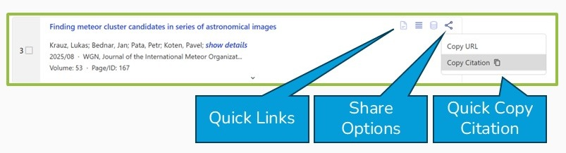
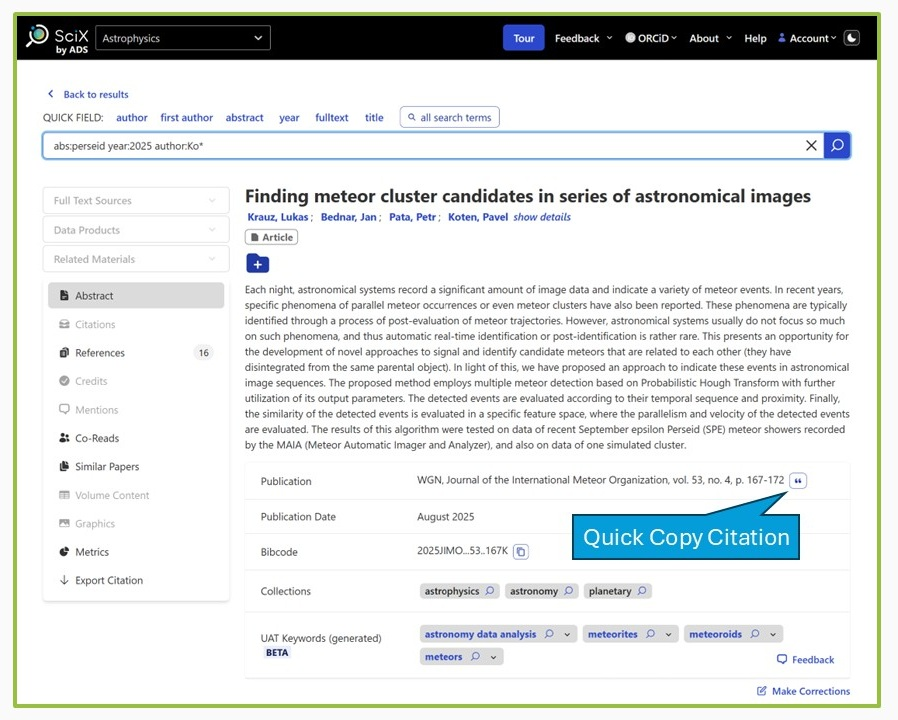
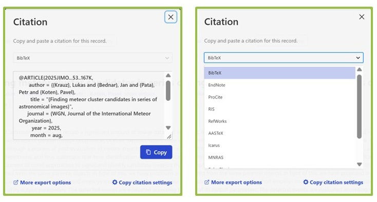
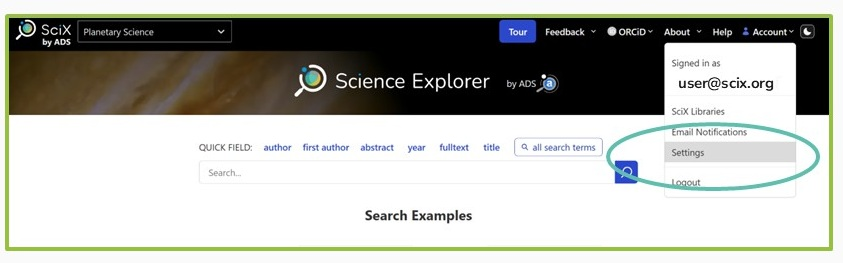
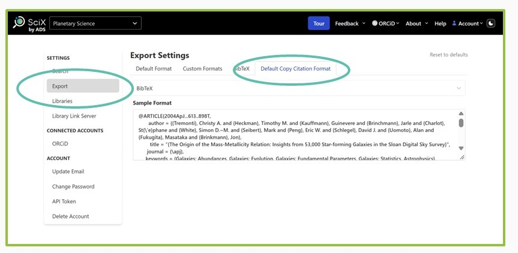
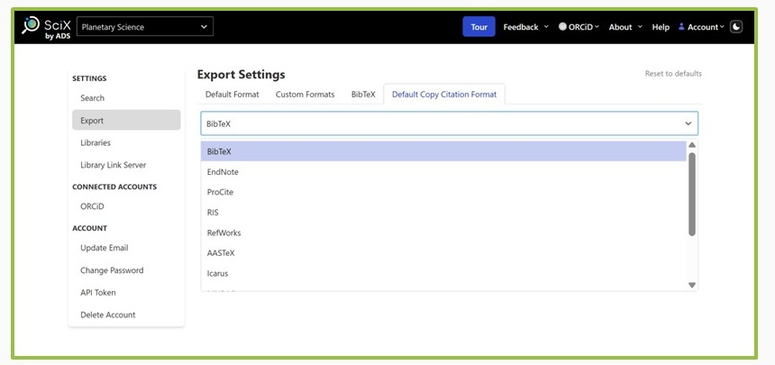

SciX lets you copy a single formatted citation quickly from two places:

* the [results view](#from-results-view), at the end of each entry's Quick Links
* the [article view](#from-article-view), at the end of the Publication information

Quick copy offers a limited set of formats. For more formats, more control over formatting, or to export many records at once, use [Export Results](../actions-scix/export).

By default, quick copy uses the American Geophysical Union (AGU) citation style. If you have a [SciX account](../userpreferences-scix/scix-account), you can [choose your own default format](#setting-your-default-format).

## From results view

Each entry in your results view has a row of [Quick Links](../actions-scix/quick-links) ending in a [Share Options](../actions-scix/quick-links#share-options) icon of three connected dots.

<figure>
   
</figure>

Click the icon and select **Copy Citation** from the menu. The formatted citation is copied to your clipboard, ready to paste into another application. The format comes from your SciX account settings, or from your selected discipline if you are not logged in.

## From article view

When [viewing an article](../actions-scix/article-view), a **Copy Citation** button appears at the right end of the Publication information.

<figure>
   
</figure>

Click the button to open the Citation panel.

<figure>
   
</figure>

The menu at the top shows your default copy citation format, and the formatted citation appears below it. Click the blue **Copy** button to copy the citation to your clipboard.

To use a different format for this citation, choose one from the menu. Only some of the formats SciX supports are available here:

* **More export options** opens [Export Results](../actions-scix/export), with the full list of formats.
* **Copy citation settings** opens your account's export settings, where you can [change your default format](#setting-your-default-format). You need to be logged in to a [SciX account](../userpreferences-scix/scix-account).

## Setting your default format

If you have a [SciX account](../userpreferences-scix/scix-account), you can choose the format quick copy uses.

<figure>
   
</figure>

1. Select **Settings** from the Account menu in the upper right of any SciX page.
2. Select **Export** from the Settings menu on the left, then the **Default Copy Citation Format** tab under Export Settings.

<figure>
   
</figure>

Your current default appears in the menu at the top, with a sample citation below it. Choose a new format from the menu.

<figure>
   
</figure>

Not every format SciX supports is available for quick copy. Your copy citation format is separate from the format set on the **Default Format** tab, which [Export Results](../actions-scix/export) uses. The two can be the same, but do not have to be.

**Reset to defaults** resets all of your export settings, including your copy citation format, to the defaults you would have without an account.
