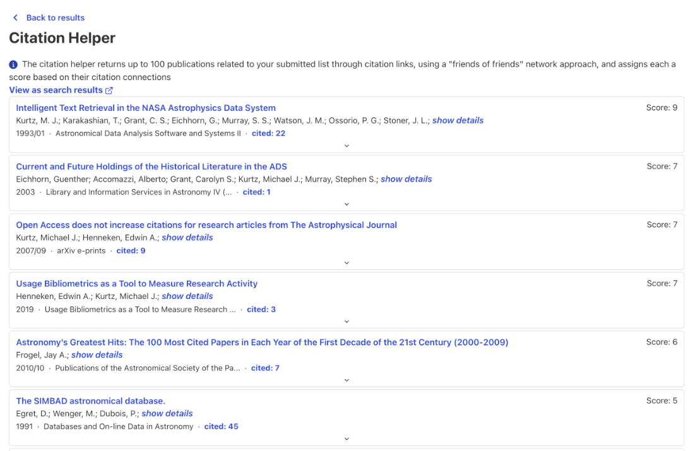

The Citation Helper suggests papers that are closely related to a set of results through citations, but are not part of that set. It is useful for checking a bibliography or a library for papers you may have missed.

## How to use it

1. Run a search, or open a library and select **View as search results**.
2. From the **Explore** menu at the top right of the results, select **Citation Helper**. Choose **Selected** first if you only want to use the results you have checked.

<figure>
   
</figure>

## What it returns

Up to 100 papers that cite, or are cited by, papers in your results, but are not in your results themselves. It works like "friends of friends": a paper connected to many of your results through citations gets a higher **score**, and the list is sorted by score.

* **View as search results** opens the suggestions as an ordinary results list, where you can sort, filter and export them.
* If you are logged in, you can select suggestions and click **Add to library** to add them to one of your [libraries](../libraries-scix/creating-libraries).
