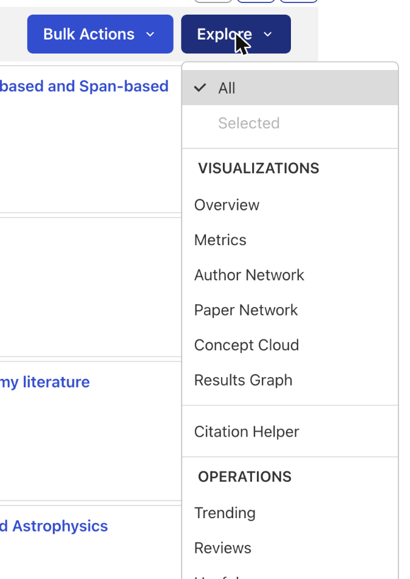
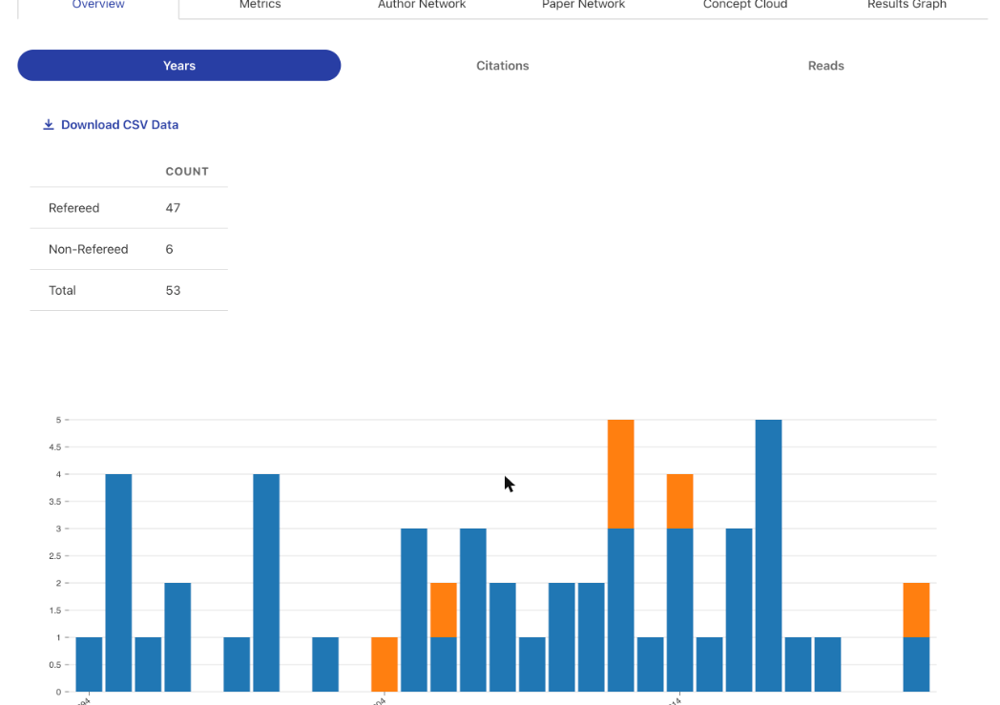

The **Explore** menu, at the top right of the search results page next to **Bulk Actions**, lets you visualize and analyze a set of results and find related papers. Choose **All** to use every result, or **Selected** to use only the results you have checked.

<figure>
   
</figure>

## Visualizations

Each visualization opens on a Visualizations page, with a tab for each one and a **Back to results** link. Most have a **Download CSV Data** link.

* **Overview**: charts your results by publication **Years**, **Citations** or **Reads**, with refereed and non-refereed papers shown separately, and a count of each.
* **Metrics**: citation, usage and index metrics for the results. See [Metrics](../actions-scix/analyze).
* **Author Network**, **Paper Network**, **Concept Cloud** and **Results Graph**: see [Visualize Results](../actions-scix/visualize).

<figure>
   
</figure>

## Citation Helper

Suggests papers related to your results through citations that are not in the results yet. See [Citation Helper](../actions-scix/citation-helper).

## Operations

Operations run a new search built from your current results, using SciX's [second-order operators](../search-scix/second-order). For example, choosing **Trending** for the search `exoplanets` runs `trending(exoplanets)`.

* **Trending**: papers most read by the people who read your results.
* **Reviews**: papers that cite many of your results, often review articles.
* **Useful**: papers that many of your results cite.
* **Similar**: papers whose abstracts are most similar to the abstracts of your results.
